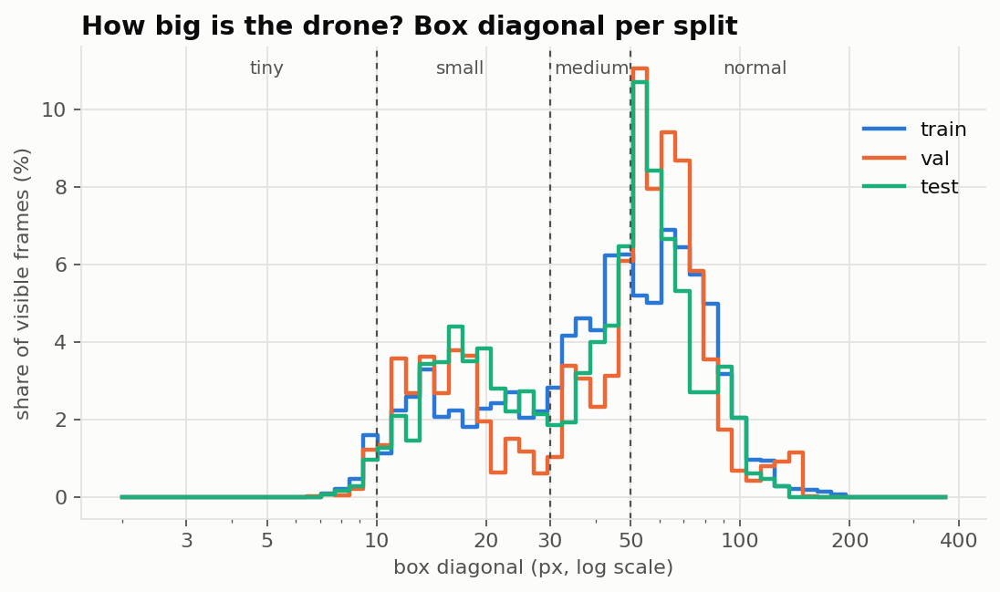

<h1 align="center">falconet</h1>

<p align="center">
  <strong>Detecting and tracking small drones in thermal infrared video, end to end in Rust.</strong><br/>
  Detector trained with Burn · ByteTrack written from scratch · INT8 and custom GPU kernels · runs in the browser
</p>

<p align="center">
  <a href="https://github.com/fransandooo/falconet/actions/workflows/ci.yml"></a>
  
  
  
  
</p>

---

## Overview

Counter-UAV systems need to spot a drone that covers a few dozen pixels of a thermal frame, keep
its identity from frame to frame, and do it fast enough to run on modest hardware. falconet is a
perception engine for that problem, built as a single Rust codebase from training to deployment:

- a **detector** designed for small targets, trained natively in [Burn](https://burn.dev);
- a **tracker**: ByteTrack (Kalman filter, Hungarian assignment, two-stage association) implemented from scratch;
- an **optimised pipeline**: INT8 quantization and hand-written GPU kernels with [CubeCL](https://github.com/tracel-ai/cubecl);
- **benchmarks** against PyTorch and ONNX Runtime on the same hardware, reported as p50 / p95 / p99 latency;
- a **browser demo** through WASM + WebGPU.

The main benchmark is [Anti-UAV410](docs/datasets/antiuav410.md): 410 thermal videos, about
438k annotated frames. A *falconet* is a small falcon: a small model hunting small targets.

> [!NOTE]
> **Work in progress.** Phase 1 of 5 (end-to-end pipeline) is underway. The data tooling,
> metrics and tracker are done and validated; the detector does not run in Rust yet. Every
> milestone is written up in [`docs/checkpoints/`](docs/checkpoints/).

---

## Results so far

**Reference detector.** Before writing the Rust detector, a small PyTorch model sets the bar it has
to match. `CenterNetLite` (1.39 M parameters, anchor-free, stride-4 output) was trained from scratch
on a 4 GB laptop GPU in 4.6 h and evaluated on the full validation split (94,711 frames; the test
split is untouched).

| Metric | Value |
| --- | ---: |
| AP50 | **0.841** |
| mAP@[.5:.95] | 0.460 |
| AP small / medium / large | 0.308 / 0.572 / 0.681 |
| State accuracy (official metric), detector only, no tracker | **0.705** |
| False positives per frame (score ≥ 0.5) | 0.047 |

Medium and large drones are found almost every time (top-box recall 98–99 %); small drones are the
weak spot (67 %). Full log: [`docs/experiments/2026-11-18-reference-antiuav410-baseline.md`](docs/experiments/2026-11-18-reference-antiuav410-baseline.md).

**Validated building blocks in Rust:**

- **Metrics.** COCO detection metrics and Anti-UAV410's official state accuracy, both
  reimplemented and checked against `pycocotools` and the official evaluation code: they agree to
  10⁻⁶. See [`docs/evaluation.md`](docs/evaluation.md).
- **Tracker.** [`falconet-track`](crates/falconet-track/) follows the official `BYTETracker.update`.
  Behaviour tests cover occlusions, low-score dips and crossing targets, and a cross-check against an
  independent Rust ByteTrack gives identical identities on all 20,000 test frames.
- **Data.** Parsers, integrity checks and statistics for Anti-UAV410, including a labelling
  subtlety (border frames with `exist = 0` but a box) that changes how the official metric scores them.

<p align="center">
  
  <br/>
  <sub>Half of all Anti-UAV410 boxes are COCO-"small"; the median drone is about 38 × 25 px.</sub>
</p>

---

## Roadmap

| Phase | Topic | Status |
| :---: | --- | --- |
| 0 | Rust + Burn fundamentals, dev environment | Done |
| 1 | End-to-end Rust pipeline with an imported model | **In progress** |
| 2 | Training in Rust + training visualizer | Planned |
| 3 | INT8 quantization and pipeline optimization | Planned |
| 4 | Custom GPU kernels with CubeCL | Planned |
| 5 | Generalization study, web demo, technical report | Planned |

---

## Repository layout

```text
falconet/
├── crates/
│   ├── falconet-core/     # shared types (bounding boxes)
│   ├── falconet-data/     # Anti-UAV410 parsing, statistics, COCO and SA metrics
│   ├── falconet-track/    # ByteTrack from scratch
│   └── falconet-mlflow/   # MLflow REST client for experiment tracking
├── reference/             # PyTorch / ONNX Runtime baselines, for comparison only
├── scripts/               # dataset download, plots and parity checks
├── playground/            # phase 0 learning exercises, not part of the product
├── docs/                  # checkpoints, experiment logs, dataset notes
└── media/                 # figures and GIFs
```

New crates (`falconet-model`, `falconet-infer`, `falconet-train`, …) are added as the phases that
need them begin.

---

## Getting started

Requirements: Linux, [rustup](https://rustup.rs), and optionally [mise](https://mise.jdx.dev) for
the extra dev tools. GPU backends need a recent NVIDIA driver (CUDA) and/or Vulkan.

```bash
git clone https://github.com/fransandooo/falconet.git && cd falconet

cargo build                          # rustup installs the pinned toolchain from rust-toolchain.toml
mise install                         # optional: cargo-nextest and bacon, scoped to this repo
git config core.hooksPath .githooks  # run fmt + clippy + tests before every push, as CI does

cargo run --release -p playground-gpu-check   # check that Burn sees your GPU
```

Everyday commands:

```bash
cargo fmt --all
cargo clippy --workspace --all-targets -- -D warnings
cargo nextest run --workspace
bacon clippy                         # re-run clippy on every save
```

**Experiment tracking.** Training runs log hyperparameters, metric curves, the git commit and
artifacts to a local [MLflow](https://mlflow.org) server, which Rust talks to over its REST API
([`crates/falconet-mlflow`](crates/falconet-mlflow/)). `mise run mlflow` starts it at
`http://127.0.0.1:5000`; training works without it when it isn't running.

---

## Datasets

No data is stored in this repository. Datasets live under `$FALCONET_DATA_DIR` (default
`~/datasets`) and are fetched with the scripts in [`scripts/`](scripts/).

| Dataset | Use | Notes |
| --- | --- | --- |
| [Anti-UAV410](docs/datasets/antiuav410.md) | Train / val / test | Thermal IR, 410 videos, 438k frames, 640 × 512; `scripts/download_antiuav410.sh` |

Anti-UAV410 has no stated licence; it is used here for research only and is not redistributed.
Please cite:

> B. Huang, J. Li, J. Chen, G. Wang, J. Zhao, T. Xu. *Anti-UAV410: A Thermal Infrared Benchmark and
> Customized Scheme for Tracking Drones in the Wild.* IEEE T-PAMI, 2023.

---

## License

Licensed under either of [Apache License, Version 2.0](LICENSE-APACHE) or [MIT license](LICENSE-MIT)
at your option.

Unless you explicitly state otherwise, any contribution intentionally submitted for inclusion in this
work, as defined in the Apache-2.0 license, shall be dual licensed as above, without any additional
terms or conditions.

<p align="center">
  <sub>Francisco Sandoval Hernández · <a href="https://www.linkedin.com/in/francisco-sandovalh">LinkedIn</a> · <a href="https://github.com/fransandooo">GitHub</a></sub>
</p>
