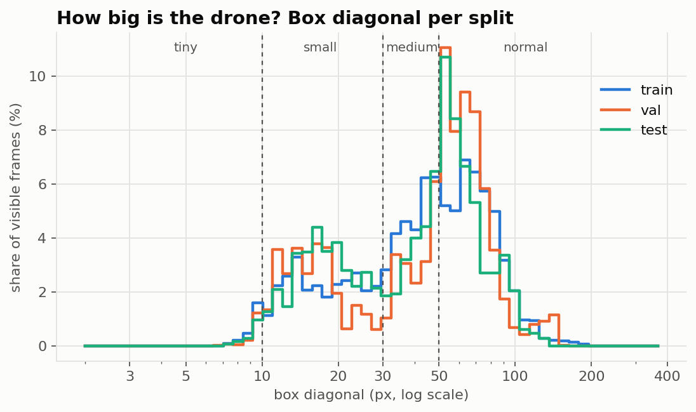
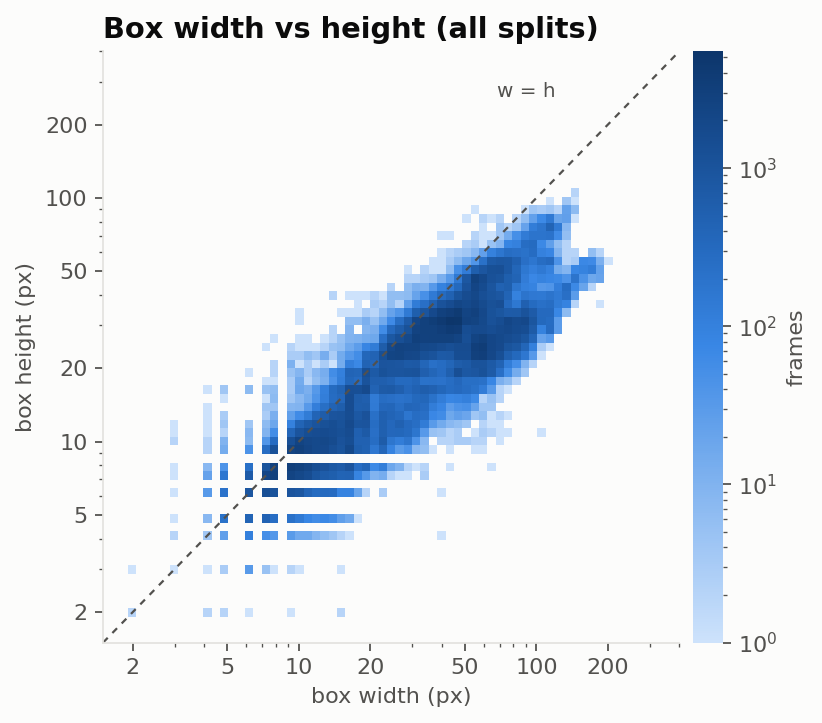
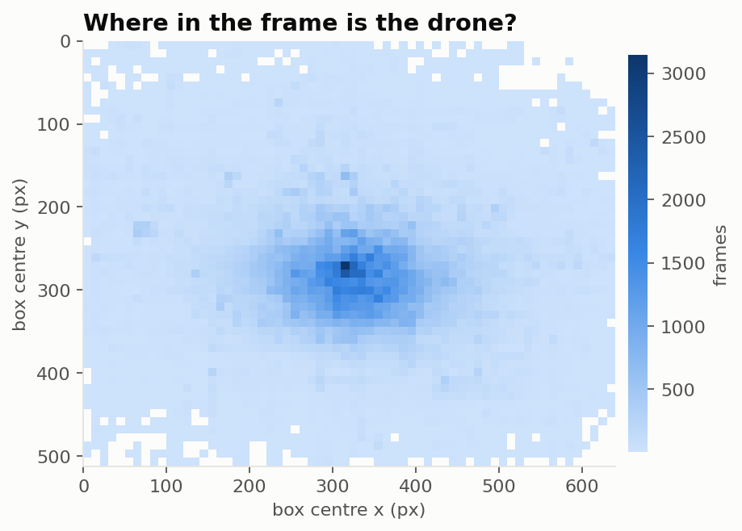
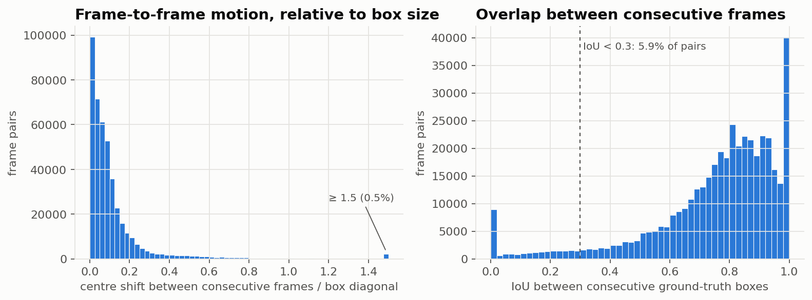
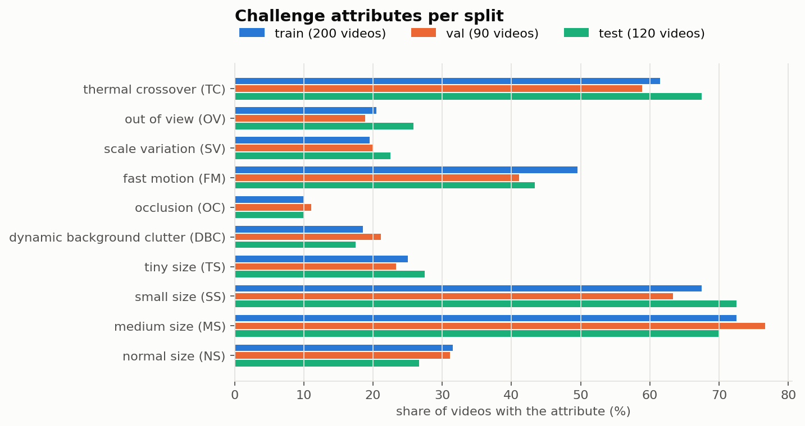

# Anti-UAV410

Main dataset of the project: single-drone tracking in thermal-infrared video.

| | |
|---|---|
| Paper | B. Huang, J. Li, J. Chen, G. Wang, J. Zhao, T. Xu, "Anti-UAV410: A Thermal Infrared Benchmark and Customized Scheme for Tracking Drones in the Wild", *IEEE T-PAMI*, 2023 |
| Toolkit | <https://github.com/HwangBo94/Anti-UAV410> (annotations, evaluation code; checked at commit `8a8eb04`) |
| Archive | `Anti-UAV410.zip`, 9,361,681,896 bytes, Google Drive (link in the toolkit README; Baidu mirror with access code `a410`) |
| Registration | none, but Google Drive enforces a daily download quota on the shared file ("Quota exceeded") |
| Licence | **not stated**: the toolkit repository has no licence file. We treat it as research use only: no redistribution of data or derived weights, and we cite the paper |
| Splits | 200 train / 90 val / 120 test videos, 438,397 annotated frames |
| Local copy | `$FALCONET_DATA_DIR/antiuav410` (default `~/datasets/antiuav410`), via `scripts/download_antiuav410.sh` |

A third-party re-upload exists on Hugging Face (`huseyincavus/anti-uav410`). It is **not byte-identical** (9,359,055,807 bytes) and attributes a CC BY-NC licence and a different paper, so we don't use it as the source of record.

## Annotation format

Two equivalent sources, both parsed by `falconet-data` (`crates/falconet-data/src/antiuav410.rs`):

- **Toolkit text files**: `annos/<split>/<sequence>.txt`, one `x,y,w,h` line per frame (pixels, top-left corner). `0,0,0,0` means the drone is not visible (occluded or out of view).
- **`IR_label.json`** inside the archive, next to each sequence's frames: `{"exist": [1, 0, ...], "gt_rect": [[x, y, w, h], [], ...]}`.
- **Attributes**: `annos/<split>/att/<sequence>.txt`, ten 0/1 flags per video in this order: thermal crossover (TC), out of view (OV), scale variation (SV), fast motion (FM), occlusion (OC), dynamic background clutter (DBC), tiny / small / medium / normal size (TS / SS / MS / NS).

## Official metric: state accuracy (SA)

From the toolkit's `Evaluation_for_SA.py`, per sequence:

- frames where the drone **is visible**: IoU between the predicted and ground-truth box (0 if no box is predicted);
- frames where it **is not visible**: 1 if the tracker reports "no target" (an empty prediction), else 0;
- visible frames with a malformed ground-truth box are skipped;
- SA = mean over frames; the benchmark score is the mean over sequences (mSA).

So a tracker is rewarded both for accurate boxes *and* for saying "nothing here" when the drone is gone. The toolkit also reports precision and success (AUC) plots.

**Our implementation:** `falconet_data::metrics::state_accuracy`, exposed as
`cargo run --release -p falconet-data --bin antiuav410 -- sa --predictions <dir> --split test`
for results in the official `{"res": [[x, y, w, h], [], ...]}` format. `scripts/check_sa_parity.py` verifies it against the official `eval()`, embedded verbatim and hash-checked against the toolkit source, so no downloaded code is executed. It uses synthetic tracker outputs for every sequence (jitter, misses, false alarms, "no target" answers). Result: max per-sequence difference 7×10⁻⁷ (f32 vs f64 rounding) on train, val and test.

Subtleties the port has to reproduce:
- frames marked visible with a **degenerate box** (zero width or height, e.g. `18,0,1,0`) are *scored*, always 0; there are 5 such frames (3 train, 2 test);
- visible frames with no box at all (`[]`, or a box summing to 0) are *skipped*;
- predictions are `zip`ped with the labels, so extra frames on either side are ignored;
- in the toolkit `.txt` files "not visible" and "visible with an all-zero box" look the same (`0,0,0,0`), so the `exist` flags in `IR_label.json` are the reference for evaluation.

## Statistics

Computed from the toolkit annotations with
`cargo run --release -p falconet-data --bin antiuav410 -- stats`, plotted with `uv run scripts/plot_dataset_stats.py`.

| | train | val | test | all |
|---|---|---|---|---|
| videos | 200 | 90 | 120 | 410 |
| frames | 213,995 | 94,711 | 129,691 | 438,397 |
| frames without the drone | 2.4% | 2.3% | 2.0% | 2.3% |
| median box (w × h) | 36 × 24 px | 43 × 25 px | 36 × 25 px | 38 × 25 px |
| box diagonal p05 / median / p95 | 12 / 45 / 95 px | 12 / 52 / 90 px | 12 / 46 / 91 px | 12 / 47 / 92 px |
| COCO-"small" boxes (area < 32²) | 53.6% | 44.0% | 50.5% | 50.6% |
| centre motion median / p95 | 2.7 / 15.8 px | 2.5 / 13.0 px | 2.6 / 17.5 px | 2.6 / 15.5 px |
| consecutive boxes with IoU < 0.3 | 6.6% | 4.7% | 5.8% | 5.9% |

Size bins by box diagonal (all splits): ≤ 10 px **2.0%**, 10–30 px **29.3%**, 30–50 px 22.9%, > 50 px 45.8%.

Sequence length: 1,000 frames typical (median), 28–1,500 overall. Absences come in 254 runs, median 14 frames, longest 385. Most videos have no absence at all, and the worst one has the drone out of sight for 62% of its frames.

## What the numbers say

1. **Small, but not as tiny as expected.** Half of the boxes are "small" by the COCO definition, and almost a third have a diagonal under 30 px, but truly tiny boxes (≤ 10 px) are only 2%. The median drone is about 38 × 25 px. The detector needs a high-resolution head (stride 4 or 8), not exotic tiny-object machinery, and AP_small is the metric to watch.
2. **The camera follows the drone.** Box centres cluster strongly around the image centre. A detector can learn the shortcut "drones are in the middle", so augmentation has to break it (random crops and translations), and evaluation should look at off-centre drones separately.
3. **Drones are wide:** median aspect ratio 1.43 (w/h).
4. **Motion is mostly gentle, with a heavy tail.** The median centre shift is 2.6 px per frame, but 5.9% of consecutive frames overlap with IoU < 0.3, and about 2% of pairs (≈ 9k) don't overlap at all (camera jumps, fast motion, or annotation errors). A tracker that associates by IoU alone (like the greedy one in exercise 3b) would lose the drone at least that often, so ByteTrack's Kalman prediction is needed.
5. **"Not visible" frames are rare (2.3%) but scored.** SA gives full credit for an empty prediction when the drone is gone, so the pipeline needs a calibrated "no target" decision (a score threshold plus the tracker's lost state), not just the best box every frame.
6. **About 8.5% of consecutive pairs have identical boxes.** These are probably static drones or copied/interpolated annotations. Literature reports roughly 5% erroneous labels in the raw data. Worth inspecting visually once the frames are available.
7. **Thermal crossover is everywhere** (≈ 60–67% of videos): the drone's temperature matches the background's, so intensity alone won't separate them.
8. **5 degenerate boxes** (zero width or height) among the visible frames. They're harmless for training once filtered out, but the metric must keep them; see above.

## Pending (needs the frames)

- [ ] Frame resolution and file layout in the archive (the paper says 640 × 512; the box positions are consistent with it)
- [ ] Consistency check: `IR_label.json` vs toolkit `.txt` for every sequence
- [ ] Sample frames showing the size range (for the video)
- [ ] Visual check of the IoU = 0 jumps and the identical-box runs
