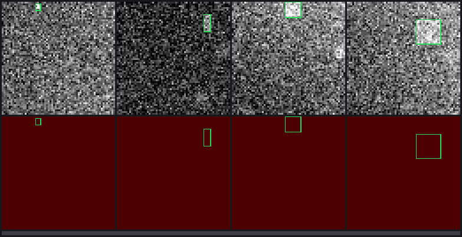

# Exercise 3d — a toy detector

The real problem in miniature: find one small bright box in a noisy 64×64 image that also contains distractor blobs, and predict its bounding box. A tiny **CenterNet-style** (anchor-free) detector trained with a hand-written loop, watched epoch by epoch.



*Top: input, green = ground truth, red = prediction. Bottom: the predicted centre heatmap. Bar: training progress.*

```bash
mise run mlflow    # optional, in another terminal: http://127.0.0.1:5000
cargo run --release -p playground-toy-detector                       # 30 epochs on CUDA, ~2 min
cargo run --release -p playground-toy-detector -- --fixed-train-set  # the overfitting variant
cargo run --release -p playground-toy-detector -- --help
```

Outputs go to `runs/toy-detector/<run>/`: `config.json`, `history.csv`, one PNG per epoch in `frames/`, `learning.gif` and the weights. With MLflow running, open the run → **Artifacts → images**, or the run's image panel: there is one frame per epoch, with a step slider, updated live while training.

## How it works

| Piece | File | Idea |
|---|---|---|
| Scenes | [`src/scene.rs`](src/scene.rs), [`src/rng.rs`](src/rng.rs) | Gradient background + noise + 0–3 soft blobs (some brighter than the target) + one box of 3–14 px. Deterministic per seed, nothing stored on disk |
| Targets | [`src/data.rs`](src/data.rs) | On a 16×16 grid (stride 4): a Gaussian bump at the centre cell, plus width/height and sub-cell offset at that cell |
| Network | [`src/model.rs`](src/model.rs) | 5 conv-BN-ReLU blocks (two with stride 2) → three 1×1 heads: heatmap, size, offset. 98k parameters |
| Loss | [`src/loss.rs`](src/loss.rs) | Penalty-reduced focal loss on the heatmap (1 positive cell vs 255 negatives) + L1 on size/offset at the centre |
| Decoding + metrics | [`src/decode.rs`](src/decode.rs) | Heatmap argmax → box. Mean IoU, recall at IoU ≥ 0.5, the same for small boxes (≤ 6 px), centre error |
| Training loop | [`src/train.rs`](src/train.rs) | forward → loss → `backward()` → `optimizer.step(lr, model, grads)`, cosine LR, validation, frame rendering |
| Frames + GIF | [`src/viz.rs`](src/viz.rs) | Drawn pixel by pixel with the `image` crate |

## Results (CUDA, 30 epochs, 8,192 scenes per epoch, 1,024 validation scenes)

| Training data | Mean IoU | Recall@0.5 | Recall@0.5, small boxes | Centre error |
|---|---|---|---|---|
| Same 8,192 scenes every epoch (`--fixed-train-set`) | 0.757 | 88.7% | 65.6% | 3.07 px |
| **Fresh scenes every epoch** (default) | **0.830** | **94.2%** | **77.1%** | **1.87 px** |

Lessons that carry over to the real project:
- **Overfitting.** With a fixed training set, training loss keeps falling (to 0.05) while validation stalls by epoch 10, and small-box recall even drops. Fresh data fixes it. On the real dataset we can't generate infinite data, so augmentation will do this job.
- **Small boxes are the hard part.** Small-box recall stays ~17 points below the overall figure. On a 3×3 px box, a 1 px error already pushes IoU below 0.5. Expect the same on Anti-UAV410.
- **Distractors.** Without them, the task was solved in one epoch (99.6% recall). With blobs brighter than the target, the model has to learn *shape*, which is closer to drones vs. birds and clouds.

## Concepts

| Concept | Where |
|---|---|
| Hand-written training loop: `GradientsParams::from_grads`, `optimizer.step` consuming and returning the model | `train.rs` |
| `model.valid()`: an inference copy without autodiff | `train.rs` |
| Implementing Burn's `Dataset` trait for generated data | `data.rs` |
| Closures as parameters (`impl FnMut(usize, &RgbImage)`) to decouple training from output | `train.rs`, `main.rs` |
| `Iterator::by_ref()` + `take(n)` to consume one stream across epochs | `train.rs` |
| `wrapping_*` arithmetic (overflow is a panic in debug Rust, not silent like C) | `rng.rs` |
| Numerically stable losses from logits (`log_sigmoid`) | `loss.rs` |

## Gotcha found here: one DataLoader per epoch leaks GPU memory

The first version built a new `DataLoader` every epoch, to change the scenes. On CUDA, GPU memory then grew by ~200 MB per epoch (318 → 636 → 830 → 1,048 → 1,192 MiB in five epochs), and the 4 GB card ran out around epoch 18. The likely cause is that each loader's worker threads leave per-thread device memory behind. With one loader iterated for the whole run, memory stays flat at ~806 MiB. Rule for the project: **build data loaders once.** Reported upstream as [tracel-ai/burn#6505](https://github.com/tracel-ai/burn/issues/6505); setting `[streaming] max_streams = 1` in `cubecl.toml` also avoids it.

## Try this

1. Set `max_distractors: 0` in `SceneConfig::default()` and retrain. How fast does it converge now?
2. Change `SMALL_MAX_SIDE` or the IoU threshold in `decode.rs` (e.g. 0.3). How much does small-box recall depend on the metric rather than the model?
3. Add a third downsampling block (stride 8). What happens to the small boxes?
